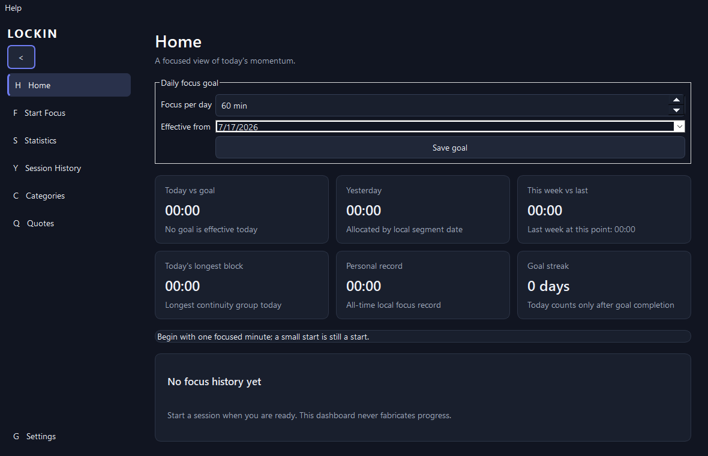

# LockIn

LockIn 1.0.1 is a local-first Windows focus timer. It combines a monotonic timer, a deliberate
full-screen focus experience, crash/sleep recovery, portable CSV history, historical goals, a
motivational dashboard, and read-only statistics without a cloud account or telemetry.



## Features

- Planned focus, pause/resume, early stop, explicit overtime, and continuity-aware blocks.
- Black focus screen, start ritual, current-monitor full screen, tray/minimize continuity, and local
  focus-window shortcuts.
- SQLite sessions, segments, distractions, heartbeats, confirmed-time recovery, and sleep auto-pause.
- Atomic portable CSV synchronization, validation, fresh-device reconstruction, and safe staged merge.
- Searchable categories and quotes, active-focus-hour quote rotation, and an optional local sound.
- Effective-dated goals, dashboard comparisons/streaks/records, Qt-native charts, heatmap, advanced
  read-only Session History, and explicit statistics export.

## Install and first launch

Download `LockIn-Setup-v1.0.1.exe` and `SHA256SUMS.txt` from the private GitHub Release, verify the
SHA-256 digest, and run the installer. It installs per user under
`%LOCALAPPDATA%\Programs\LockIn`; no Python, terminal, or administrator access is required. The build
is unsigned, so Windows SmartScreen may show a warning.

The portable ZIP must be fully extracted before running `LockIn\LockIn.exe`. Portable mode changes
application placement only—user data still lives outside the executable folder.

## Data and privacy

- Runtime SQLite: `%LOCALAPPDATA%\LockIn\runtime`
- Logs/backups/diagnostics: sibling folders under `%LOCALAPPDATA%\LockIn`
- Portable history: the Windows Documents known folder under `LockIn\portable_data`

Environment overrides `LOCKIN_RUNTIME_ROOT`, `LOCKIN_PORTABLE_ROOT`, and `LOCKIN_SETTINGS_PATH` are
available for development and diagnostics. Runtime and portable roots may not collide. Uninstalling
the application does not delete focus history. LockIn has no telemetry, cloud account, Spotify,
global keyboard hook, kiosk behavior, or automatic Git operation.

See [moving to a new device](docs/07_MOVE_TO_NEW_DEVICE.md),
[recovery](docs/03_FOCUS_SESSION_GUIDE.md), [storage](docs/05_DATA_STORAGE.md), and
[analytics definitions](docs/18_ANALYTICS_AND_HISTORY.md).

## Development and tests

```powershell
py -3.12 -m venv .venv
.\.venv\Scripts\python.exe -m pip install -e ".[dev]"
.\.venv\Scripts\python.exe -m pytest -q
.\.venv\Scripts\python.exe -m ruff check .
.\.venv\Scripts\python.exe -m ruff format --check .
.\.venv\Scripts\python.exe -m mypy app scripts
```

Build commands:

```powershell
.\scripts\clean_build.ps1
.\scripts\build_windows.ps1
.\scripts\smoke_test_packaged.ps1
.\scripts\build_installer.ps1
.\.venv\Scripts\python.exe scripts\create_release_artifacts.py
.\.venv\Scripts\python.exe scripts\final_release_check.py --post-build
```

Build output is ignored by Git. Packaging uses generated sanitized starter resources and never reads
live `portable_data`.

## Release and limitations

The private v1.0.1 release contains only the installer, portable ZIP, and checksums. Windows 10/11
x64 is the supported release target. The binary is unsigned and no clean second PC or code-signing
certificate is supplied. Cloud sync, Spotify, auto-update, global shortcuts, kiosk/system blocking,
macOS, and Linux are intentionally absent.

LockIn is MIT licensed and authored/published by Surabhi Nair. See [SECURITY.md](SECURITY.md),
[CONTRIBUTING.md](CONTRIBUTING.md), and [RELEASE_NOTES.md](RELEASE_NOTES.md).
